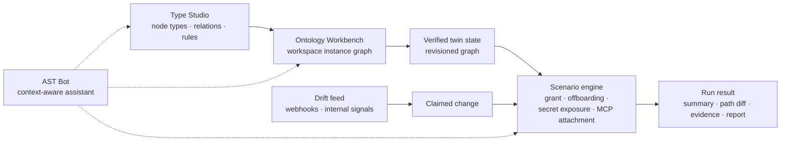

# AgentSec Twin

**See what an AI agent will be able to reach before you give it access.**

AgentSec Twin is a security workbench that models AI agents, the MCP servers they connect to and everything around them as a digital twin, then simulates a change before it happens. Grant a permission, offboard an owner, leak a secret or attach an MCP server, and see exactly which access paths open or close.

> [!NOTE]
> This repository is a project showcase. The source code is private; a walkthrough is available on request.

  <video src="https://github.com/user-attachments/assets/08e8cc3d-a82a-4de6-9da0-2453bc2e5eb9#t=1" width="100%" controls autoplay loop muted></video>

## Why

Security reviews ask *"is the current configuration safe?"* AI agents make that the wrong question. An agent is not one account with one permission: it has an owner, tools, credentials, MCP servers and policies, and a small change to any of them can open a path to data nobody intended it to touch. Checking each permission in isolation misses the path; reviewing logs finds it after the fact.

AgentSec Twin asks a different question: **what does this change make reachable, and why?**

| | Conventional review | AgentSec Twin |
|---|---|---|
| Core question | Is the current setup safe? | What paths and impact does this change create? |
| Method | Check permissions, policies and events one by one | Model agents, tools, MCP servers, secrets, policies and assets as one graph |
| Change analysis | Read the change in a ticket or a log | Diff the workspace graph before and after |
| Output | Findings, alerts, logs | Summary, graph and path diff, evidence and a report |
| AI context | The agent is just another account | Owner, tools, secrets and MCP servers of each agent in one twin |

## How it works

The model separates three things: the **verified twin state** (the graph as it is), **claimed changes and drift** (what someone says changed, or what a webhook reports), and **simulation evidence** (what the change actually does to reachability). Keeping them apart means a claimed change can be checked against the verified state before anyone acts on it.

## Features

- **Overview.** Twin state, drift feed, watchlist and recent simulation runs on one screen, so it is clear what needs analysis next.
- **Type Studio.** Define node types, relation types, required properties and allowed connections for agents, owners, tools, MCP servers, secrets, policies and assets, in a consistent graph schema.
- **Ontology Workbench.** Build the real workspace graph on top of those rules in a visual editor, with saved revisions.
- **Drift feed.** Change events from external webhooks (Linear today) and internal signals appear as a stream of claimed changes.
- **Scenario simulation.** Run a change against the saved graph and compare access paths and blast radius before and after.
- **Runs and results.** Every run is stored and reopenable as a summary, a graph and path diff, the evidence behind each finding, and a report.
- **AST Bot.** An assistant that reads the project and the current screen to help build the twin, write schemas and draft scenarios in natural language.

### Built-in scenarios

| Scenario | What it answers |
|---|---|
| `grant` | Which new access paths appear when an agent is given a permission? |
| `offboarding` | When an owner leaves, which agents become ownerless and what can they still reach? |
| `secret_exposure` | If a secret or link leaks, how far can it spread and which assets become reachable? |
| `mcp_attachment` | Attaching an MCP server: which tools come into scope, which credentials does it depend on, and is there an exfiltration path? |

## Tech stack

| Area | Stack |
|---|---|
| Frontend | Next.js 16, React 19, TypeScript, Tailwind CSS, React Flow (@xyflow/react), Dagre |
| Backend | FastAPI, Pydantic, SQLAlchemy, Uvicorn |
| Storage | SQLite by default, synthetic workspace seed |
| Contracts | Ontology schema, scenario input contract, simulation result contract |
| Analysis | Graph path analysis, before/after diff, scenario execution engine |
| AI | OpenAI-compatible API, screen-context assistant |
| Integration | Linear webhooks for change events |
| Tooling | npm workspaces, Docker Compose, pytest |

## Status

MVP complete: type definition, workspace graph editing, four simulation scenarios, stored runs and the assistant work end to end on a synthetic workspace. The design takes cues from Palantir AIP's ontology-first approach.

---

More projects at [hhkb.dev](https://hhkb.dev) · [Intbox](https://intbox.org)
